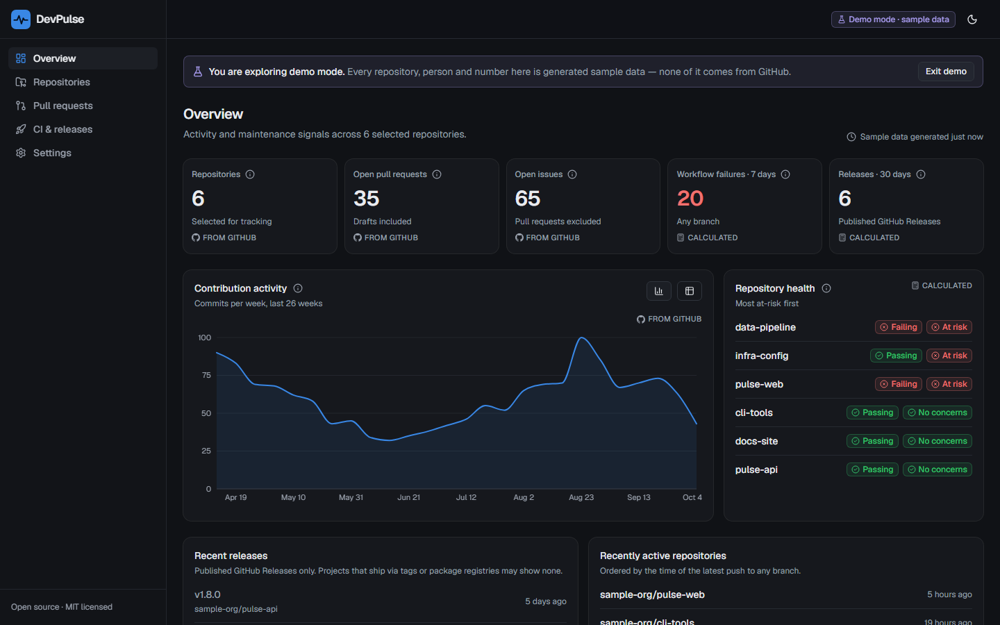
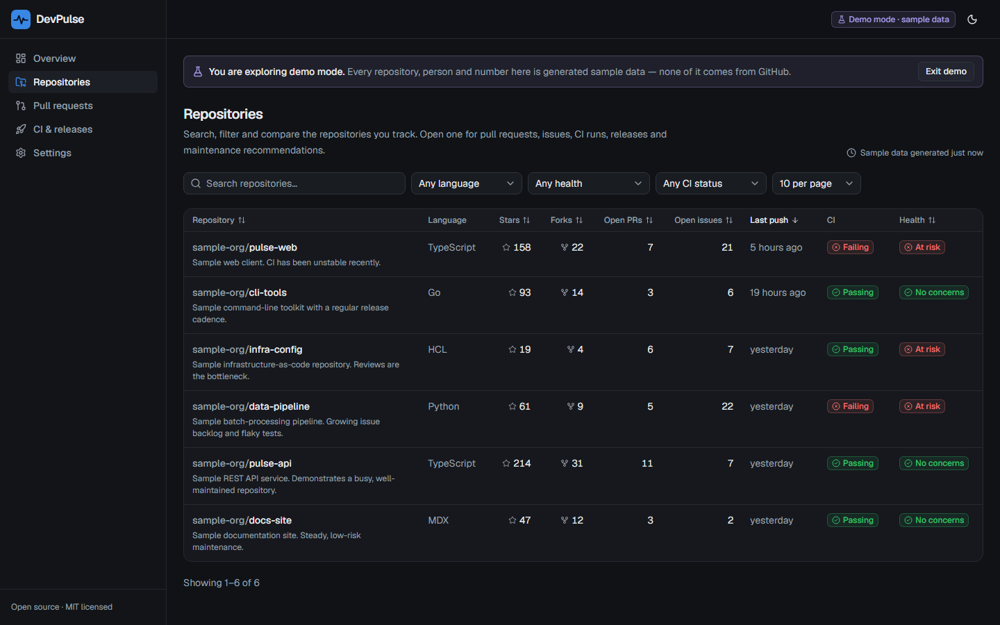
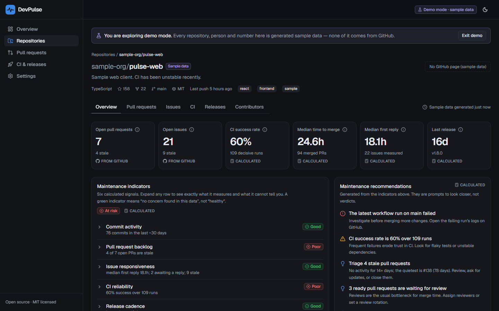
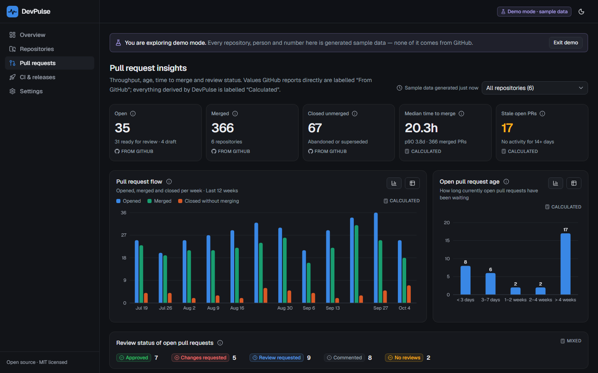
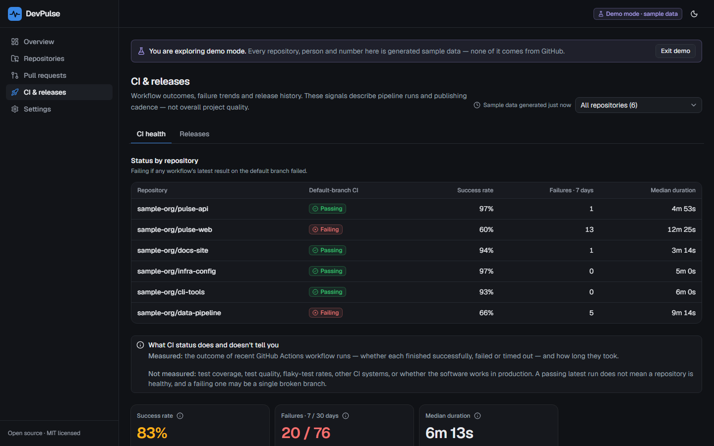

# DevPulse

**An open-source GitHub intelligence dashboard.** DevPulse turns repository activity into signals you can act on — pull request flow, CI reliability, release cadence, and maintenance risks — and tells you exactly what each number does and doesn't measure.



> **Project status: pre-1.0.** No release has been published and DevPulse has not been deployed anywhere by its authors. Demo mode is complete and needs no setup. Live mode (your real GitHub data) is implemented and tested, but see [Known limitations](#known-limitations): the OAuth round-trip with github.com itself is not exercised by automated tests, so please report anything that misbehaves.

## Why DevPulse

GitHub shows you activity; it rarely tells you whether a project is healthy. DevPulse answers questions like:

- Are pull requests waiting on review, and for how long? Which ones have gone stale?
- Is CI reliable, or does it fail a third of the time? Is that one broken branch or everywhere?
- When was the last release? Is there a cadence?
- Is the work concentrated in one person's hands?

Every metric is **defined in the UI** and labelled either **From GitHub** (a value the API reports directly) or **Calculated** (derived by DevPulse, depending on a data window or a threshold you control). When GitHub only gives a partial view — a truncated list, statistics still being computed, a repository you lack permission for — DevPulse says so next to the number instead of showing a confident zero.

## Screenshots

All screenshots are of **demo mode**, which uses generated sample data (clearly labelled in the app). They are produced by [`scripts/screenshots.mts`](scripts/screenshots.mts).

| Repository explorer                                               | Repository detail                                          |
| ----------------------------------------------------------------- | ---------------------------------------------------------- |
|     |  |
| **Pull request insights**                                         | **CI & releases**                                          |
|  |   |

Light theme and mobile layouts: [overview (light)](docs/screenshots/overview-light.png) · [overview (phone)](docs/screenshots/overview-mobile-dark.png).

## Features

Everything below is implemented and covered by tests.

**Dashboard**

- **Overview** — repositories, open pull requests and issues, workflow failures (7 days), releases (30 days), contribution activity, per-repository health, recent releases, recently active repositories and an activity feed.
- **Repository explorer** — search, filter (language, health, CI status), sort and paginate; all state lives in the URL, so views are shareable.
- **Repository detail** — overview, pull requests, issues, CI, releases (with tags and deployments) and contributors; six maintenance indicators, each expandable to show what it measures _and what it does not_; maintenance recommendations; links to GitHub.
- **Pull request insights** — open / merged / closed-unmerged, draft vs ready, age, median and p90 time to merge, review status, stale pull requests, and a "waiting for first review" list.
- **CI & releases** — workflow outcomes by day, per-workflow breakdown, run list with links to logs, release history, tags and deployments. An explicit panel explains why a passing run does not mean a repository is healthy.
- **Settings** — theme (dark by default, light, system), the thresholds behind calculated metrics, tracked repositories, data refresh mode, rate-limit status and account disconnection.

**Product qualities**

- **Honest data** — partial, sampled, truncated and unavailable data is called out in place; sample data can never be mistaken for real data.
- **Charts** — hover tooltips, legends, a table view for every chart, and a colour palette validated for colour-vision separation.
- **Accessible** — keyboard navigation, visible focus, skip link, ARIA labelling, status always conveyed by text/icon as well as colour. Automated axe scans of every page in both themes are clean.
- **Responsive** — desktop, tablet and phone layouts, with no page-level horizontal scrolling (tested).

**Live mode** (your real data)

- GitHub sign-in that **starts with no scopes** (public data only). Private repositories are a separate, explicit opt-in.
- Access tokens are encrypted at rest and never leave the server.
- Pagination with explicit caps, rate-limit handling, ETag revalidation, an explicit-TTL cache, manual refresh, and per-resource availability (a missing permission degrades one section, not the page).
- **Disconnect** revokes the token at GitHub and deletes everything DevPulse stores about you.

## Try it in 30 seconds

Demo mode needs no GitHub account, database or credentials.

```bash
git clone https://github.com/Leoelo4/DevPulse.git
cd DevPulse
npm install
npm run dev
```

Open <http://localhost:3000> and choose **Explore the demo**. Requires **Node.js 22.12 or newer**.

## Live mode setup

Live mode analyses repositories you can access on GitHub. It needs a PostgreSQL database and a GitHub OAuth App.

### 1. Create a GitHub OAuth App

1. Go to **GitHub → Settings → Developer settings → OAuth Apps → New OAuth App** (<https://github.com/settings/developers>).
2. Set **Homepage URL** to your app's URL (for local development: `http://localhost:3000`).
3. Set **Authorization callback URL** to `<your app URL>/api/auth/callback/github` (locally: `http://localhost:3000/api/auth/callback/github`).
4. Create the app, copy the **Client ID**, and generate a **Client secret**.

DevPulse requests **no scopes** by default, which grants read access to public data only. If a user opts in to private repositories, DevPulse requests the `repo` scope (see [Security considerations](#security-considerations) for why that is broad). Organizations that restrict third-party OAuth apps must approve DevPulse before their repositories become visible.

### 2. Start PostgreSQL

```bash
docker compose up -d
```

(Or use any PostgreSQL instance and set `DATABASE_URL` accordingly. DevPulse is tested against PostgreSQL 17.)

### 3. Configure and run

```bash
cp .env.example .env      # then fill in the values (see the table below)
npx prisma migrate deploy
npm run dev
```

Generate the auth secret with `openssl rand -base64 32`. When every variable is set, **Connect GitHub** on the landing page becomes active; if any are missing it stays disabled and tells you exactly which.

## Environment variables

Demo mode needs **none** of these. Live mode needs **all** of them; a partial configuration is reported by name on the landing page.

| Variable               | Required for live mode | Description                                                                                                                      |
| ---------------------- | ---------------------- | -------------------------------------------------------------------------------------------------------------------------------- |
| `DATABASE_URL`         | yes                    | PostgreSQL connection string (users, sessions, selected repositories).                                                           |
| `BETTER_AUTH_SECRET`   | yes                    | At least 32 characters. Signs sessions and **encrypts stored OAuth tokens**. Rotating it invalidates sessions and stored tokens. |
| `BETTER_AUTH_URL`      | yes                    | Public base URL of the app, no trailing slash. Must match the OAuth callback origin.                                             |
| `GITHUB_CLIENT_ID`     | yes                    | OAuth App client ID.                                                                                                             |
| `GITHUB_CLIENT_SECRET` | yes                    | OAuth App client secret. Server-side only.                                                                                       |

`.env.example` contains these names with no values. `.env` is git-ignored; never commit real secrets.

## Commands

| Command                                            | What it does                                                                                            |
| -------------------------------------------------- | ------------------------------------------------------------------------------------------------------- |
| `npm run dev`                                      | Start the development server                                                                            |
| `npm run build` / `npm start`                      | Production build / serve it                                                                             |
| `npm run lint`                                     | ESLint                                                                                                  |
| `npm run format` / `format:check`                  | Prettier (write / check)                                                                                |
| `npm run typecheck`                                | TypeScript, strict mode                                                                                 |
| `npm test`                                         | Unit and component tests (Vitest)                                                                       |
| `npm run test:integration`                         | Real-database integration tests — needs `INTEGRATION_DATABASE_URL`, see [CONTRIBUTING](CONTRIBUTING.md) |
| `npm run test:e2e`                                 | End-to-end tests (Playwright, demo mode; builds first)                                                  |
| `npm run screenshots`                              | Regenerate the README screenshots from a running instance                                               |
| `npm run docs:check-links`                         | Verify that relative links in the Markdown docs resolve                                                 |
| `npm run db:generate` / `db:migrate` / `db:deploy` | Prisma client / dev migration / production migration                                                    |

First time running e2e: `npx playwright install chromium`.

## Architecture

```
            ┌────────────── Next.js App Router (server components) ──────────────┐
 Browser ──▶│  pages ──▶ loadDashboard() ──▶ requireViewer() ──▶ DataSource      │
            │                │                    │                  │          │
            │                ▼                    ▼                  ▼          │
            │          lib/metrics          demo cookie /     DemoDataSource    │
            │   (pure functions, `now`      Better Auth       GitHubDataSource  │
            │    injected, unit-tested)     session                 │           │
            └───────────────────────────────────────────────────────┼───────────┘
                                                                    ▼
                                      Octokit (throttling, retry) ◀─ ETag cache
                                              │                      TTL cache
                                              ▼
                                         GitHub REST API          PostgreSQL: users, sessions,
                                                                   encrypted tokens, selections
```

- **One seam for data.** `DemoDataSource` and `GitHubDataSource` both implement `DashboardDataSource` and produce the same plain, JSON-serialisable domain objects (`src/lib/domain`). Pages never know which one they have.
- **Missing data is a type, not a zero.** Every dataset is a `Resource<T>`: `ok` (complete or partial), `pending`, or `unavailable` with a reason. The UI cannot read the data without handling the other cases.
- **Metrics are pure.** Everything in `src/lib/metrics` takes data plus an injected `now` and returns values; no I/O, fully deterministic.
- **Authorization lives in the data layer.** The proxy only does an optimistic redirect. Every page, action and route calls `requireViewer()` on the server; repository selection is checked against GitHub with the user's own token.
- **Persistence is minimal.** PostgreSQL holds only users, sessions, encrypted tokens and selected repository names. Repository data is never stored; it is fetched and cached in memory.

Design decisions are recorded in [`docs/adr`](docs/adr), and every metric's definition is in [`docs/metrics.md`](docs/metrics.md).

### Project structure

```
src/
  app/                Next.js routes, layouts, server actions
    (app)/            authenticated shell: overview, repositories, pull-requests, ci-releases, settings, onboarding
  components/         ui/ (shadcn), layout/, charts/, common/, insights/, tables/, repos/, repo-detail/, settings/, onboarding/
  lib/
    domain/           shared types (Repository, PullRequest, Resource, …)
    metrics/          pure metric calculations
    data/             DataSource interface, demo generator, request-scoped loaders
    github/           Octokit client, parsing (Zod), pagination, errors, ETag fetch, live data source
    cache/            TTL cache and freshness rules
    auth/             Better Auth config, session, viewer (demo/live)
    db/               Prisma client and selection store
    live/             selection service, token revocation, rate-limit reader
    repos/            explorer query logic and selection validation
  test/, test-integration/   shared builders, fake GitHub, real-database tests
prisma/               schema and migrations
e2e/                  Playwright specs
docs/                 ADRs, metric reference, screenshots
```

## Technology

Next.js 16 (App Router, Cache Components) · React 19 · TypeScript 5.9 (strict) · Tailwind CSS 4 · shadcn/ui · Recharts · Zod 4 · Octokit 5 · Better Auth · PostgreSQL with Prisma 7 · Vitest · Playwright (+ axe) · ESLint · Prettier · GitHub Actions.

Several choices deliberately lag "latest" for compatibility; each is explained in [ADR 0001](docs/adr/0001-stack-and-dependency-choices.md) (for example, TypeScript stays on 5.9 because `typescript-eslint` does not yet support newer versions, and Prisma stays on 7.10 because `prisma@latest` currently points at a release candidate).

## Testing and CI

- **Unit and component tests** cover metric calculations, GitHub response parsing, pagination, API failures, rate-limit handling (driving the real Octokit client against a fake GitHub), caching, authentication and authorization boundaries, input validation, and loading / error / empty / partial / demo states.
- **Integration tests** run the Prisma adapter and the real Better Auth against a real PostgreSQL (migrations, cascading deletes, session signing, token encryption, cross-user isolation). They do **not** call GitHub.
- **End-to-end tests** (Playwright, demo mode, no credentials) cover navigation, protected routes, the explorer, settings, responsive layouts and automated accessibility (axe) on every page in both themes.
- **CI** (`.github/workflows/ci.yml`) runs install, a production-dependency audit, lint, format check, type check, unit tests and build (Node 22 and 24), plus integration (PostgreSQL service container) and e2e jobs.

No test needs personal credentials or private repositories.

## Deployment

> These instructions have **not** been exercised on a hosting provider by the authors. The Node path is the one verified locally.

**Any Node.js host (recommended — it keeps the in-memory caches warm):**

```bash
npm ci
npx prisma migrate deploy      # with DATABASE_URL pointing at your production database
npm run build
npm start                      # listens on $PORT (default 3000)
```

Set the [environment variables](#environment-variables) on the host, and set the OAuth App's callback URL to `https://<your domain>/api/auth/callback/github`.

**Vercel or other serverless platforms:** import the repository, set the environment variables, and run `npx prisma migrate deploy` against the production database from your machine or CI (not necessarily during the build). `postinstall` generates the Prisma client. Note that DevPulse's caches are in-process, so on serverless each instance starts cold and does more GitHub requests; see [Known limitations](#known-limitations).

**Demo-only deployment:** deploy with no environment variables. Live mode stays switched off and the landing page says so.

## Security considerations

- **Tokens stay on the server.** Modules that handle tokens or secrets are marked `server-only`, so importing them from a client component is a build error. GitHub access tokens are encrypted at rest (XChaCha20-Poly1305 via Better Auth, keyed by `BETTER_AUTH_SECRET`) and are never serialised into props, responses or logs.
- **Minimum permissions.** Sign-in requests no scopes (public data only). Private access is an explicit opt-in that requests GitHub's OAuth `repo` scope — which is **broad** (it also permits writes), even though DevPulse only reads. If that is unacceptable for you, stay on public-only access.
- **Authorization is server-side.** A cookie's presence proves nothing; sessions are validated on every request, and viewer resolution fails closed. Selecting a repository requires that GitHub grants _your_ token access to it.
- **Input is validated** with Zod: repository names (including path-traversal forms like `..`), query strings (hostile values fall back to defaults), preference cookies (tampered values fall back to defaults) and environment variables.
- **Rendered links are allow-listed.** URLs from the API are only rendered if they are `https` on a GitHub host.
- **Headers.** `X-Content-Type-Options`, `X-Frame-Options: DENY`, `Referrer-Policy` and `Permissions-Policy` are set. A Content-Security-Policy is not yet set (it is on the [roadmap](ROADMAP.md)).
- **Disconnect** revokes the token at GitHub (best effort, and it tells you if it could not confirm) and deletes your user, sessions, tokens and selections.

To report a vulnerability, see [SECURITY.md](SECURITY.md).

## Known limitations

Honest list; several are on the [roadmap](ROADMAP.md).

- **Real OAuth is not covered by automated tests.** Everything around the GitHub OAuth exchange is tested (authorization URL and scopes, session cookies, token encryption, the data layer), but the code exchange with github.com is not. Treat the first real sign-in on a new deployment as a smoke test.
- **Partial views by design.** Per repository DevPulse reads the 300 most recently updated pull requests, the 300 most recently updated items in GitHub's issues feed (which also contains pull requests, so you may see fewer than 300 issues), up to 500 recent issue comments (for reply times), 300 workflow runs from the last 30 days, 30 releases, 30 tags, 8 deployments, and review histories for the 25 most recently updated open pull requests. At most 12 repositories can be tracked. Anything cut short is flagged in the UI.
- **Reply times** are only measured for issues opened in the last 30 days, and bot replies count as replies.
- **CI duration is approximate** (`updated_at − run_started_at`); GitHub offers no authoritative run duration. Only GitHub Actions is measured.
- **Statistics endpoints** (commit activity, contributors) are computed lazily by GitHub and cover the default branch only; they can answer "still computing" for a minute or two on first request.
- **Caches are per server process.** A restart, or another instance, starts empty. Failures are cached for only a minute.
- **GitHub OAuth `repo` scope is broad.** A GitHub App with fine-grained read-only permissions is not supported yet. GitHub Enterprise Server is not supported.
- **Preferences are per browser** (stored in a cookie), not per account.
- **Contributor avatars are not shown**; accounts are identified by login.
- **Windows + OneDrive:** a repository inside a synced OneDrive folder can hit `EPERM` errors on `.next`. Pause syncing or keep the project outside OneDrive.

## Roadmap

See [ROADMAP.md](ROADMAP.md) for planned work grouped by area (accessibility, performance, documentation, API reliability, features) with scoped, contribution-ready items.

## Contributing

Contributions are welcome — please read [CONTRIBUTING.md](CONTRIBUTING.md) and the [Code of Conduct](CODE_OF_CONDUCT.md). Bug reports and feature requests use the issue templates; changes go through pull requests, and new behaviour should come with tests.

## License

[MIT](LICENSE)
